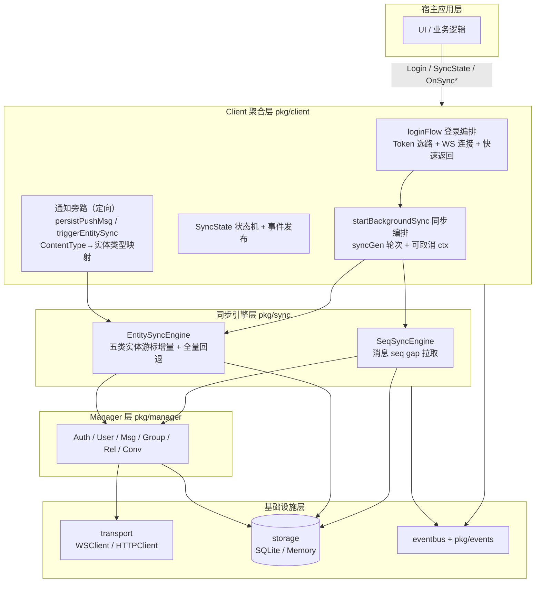
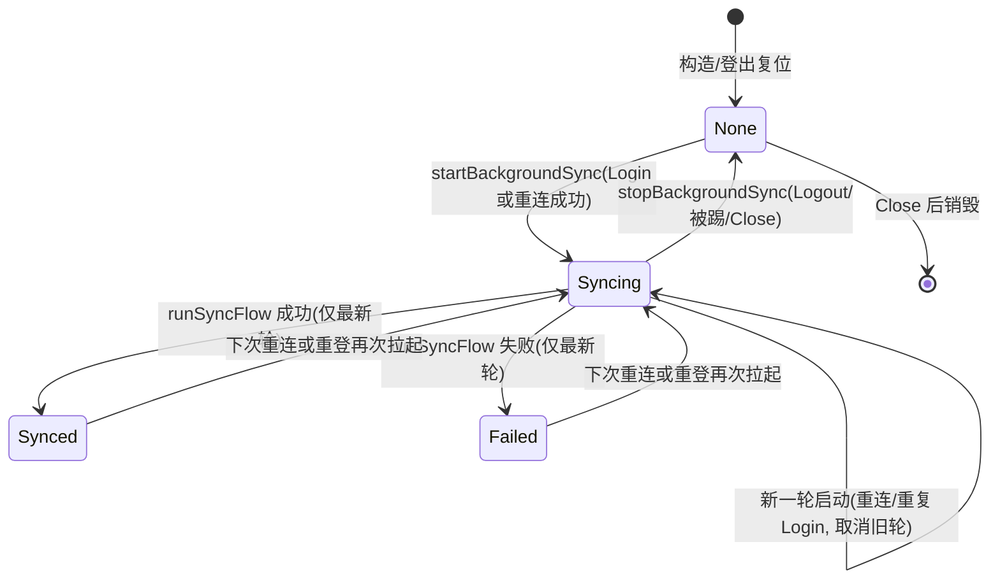
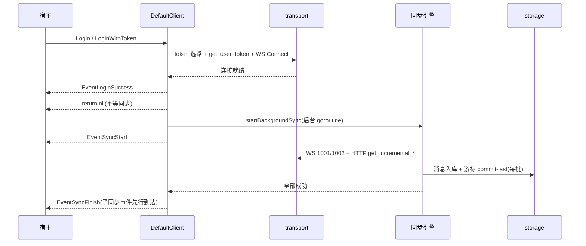
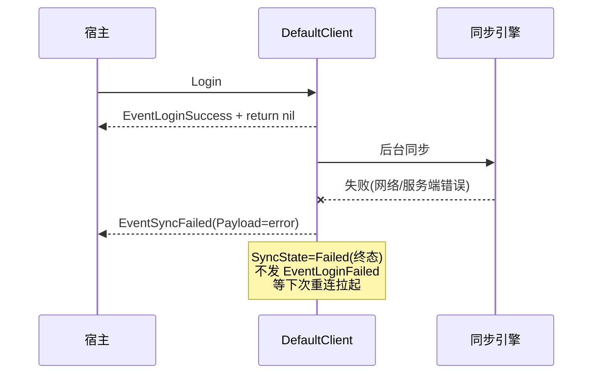
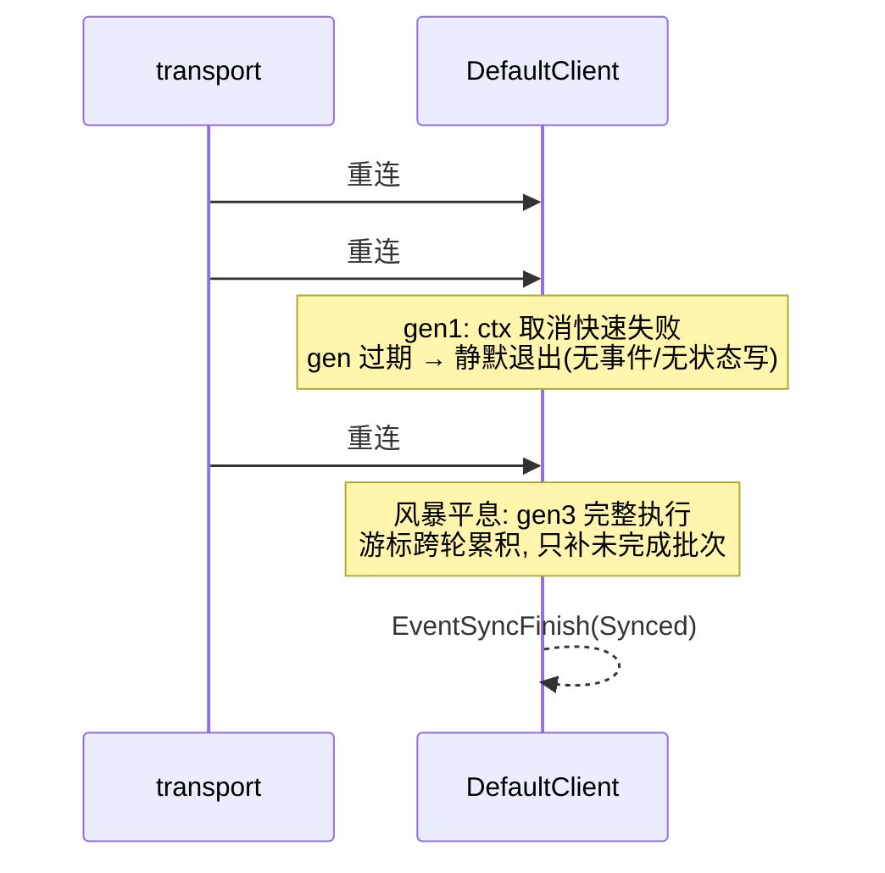
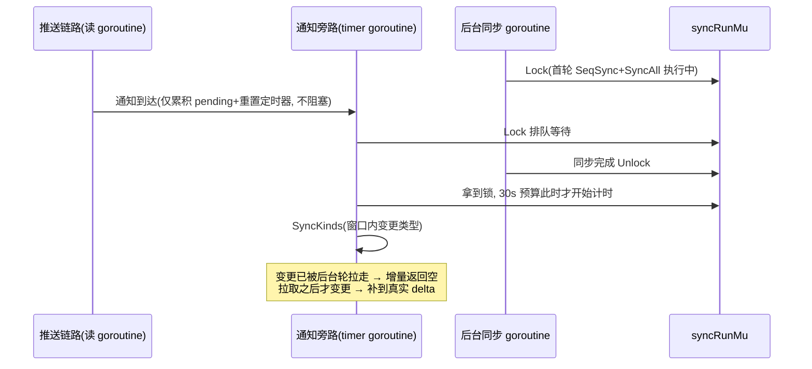

# goim-sdk-core 登录与同步解耦架构设计

| 项 | 内容 |
|---|---|
| 版本 | v1.1（2026-10-31，代码已落地后逆向整理） |
| 类型 | 技术架构文档（Brownfield 重构，Medium 深度） |
| 关联 | `docs/INTEGRATION_TEST_PLAN.md`（E1 节解耦契约、E7.3 风暴验证） |
| 实现 | `pkg/client/client_impl.go`、`pkg/sync/`、`pkg/client/client.go` |

证据标注约定：`[Data-backed]` 已在代码中核实；`[Expert judgment]` 设计决策与理由；`[Hypothesis]` 待集成测试确认（标注确认手段）。

---

## 1. 设计概述

### 1.1 目的与范围

本设计覆盖登录流程与数据同步的解耦：登录编排、后台同步生命周期、同步状态机、事件契约、通知旁路与并发控制。

不在范围内：跨语言封装（gomobile/wasm）、服务端同步接口实现、E2E 测试用例设计（见 INTEGRATION_TEST_PLAN.md）。

### 1.2 需求追溯

改造无独立 PRD，以下需求来自改造评审结论（会话内确认的方案 A），实现后均已落地 `[Data-backed]`：

| # | 需求 | 满足点 |
|---|---|---|
| R1 | 登录耗时不受首拉数据量拖累（对齐微信/Telegram 的解耦做法） | loginFlow 不再阻塞等待同步 |
| R2 | 连接成功与数据就绪在语义上分离 | EventLoginSuccess 语义收敛；新增 Sync 生命周期事件 |
| R3 | 同步失败不污染登录结果 | 同步失败发 EventSyncFailed，不再伪装 EventLoginFailed |
| R4 | 同步进度可查询、可订阅 | SyncState() 状态机 + EventSyncStart/Finish/Failed |
| R5 | 登出/被踢/销毁后同步不残留 | 可取消 ctx + stopBackgroundSync |

### 1.3 术语

| 术语 | 含义 |
|---|---|
| 后台同步 | 登录/重连后由 `startBackgroundSync` 在独立 goroutine 执行的 SeqSync + EntitySync 全流程 |
| 通知旁路 | 实时推送驱动的实体增量同步（去抖 500ms），不经过状态机 |
| seq 游标 | 每会话已拉取的最大/最小 seq，持久化于 Storage，gap 拉取据此续传 |
| 实体游标 | 五类实体增量接口的 versionID/version，持久化于 Storage |
| 轮次（syncGen） | 后台同步的单调递增代数，用于失效旧一轮 goroutine |
| commit-last | SeqSync 每批消息入库后才落游标，失败重试只补未完成批次 `[Data-backed]`（`pkg/sync/msg.go`） |

---

## 2. 整体架构分层

### 2.1 分层图



分层间依赖单向向下，无环 `[Data-backed]`（import 关系核对）。

### 2.2 分层职责与边界

| 层 | 职责 | 明确不负责 | 向下依赖 |
|---|---|---|---|
| 宿主应用层 | 订阅事件、渲染 UI、调用业务 API | 任何同步时序控制 | Client 聚合层 |
| Client 聚合层 | 登录编排、同步生命周期与状态机、推送分流、事件契约 | 具体拉取逻辑、数据存储格式 | 同步引擎层、Manager 层、eventbus |
| 同步引擎层 | gap 拉取与游标推进（SeqSync）、实体增量与全量回退（EntitySync） | 连接管理、登录编排 | Manager 层（数据源接口）、storage、eventbus |
| Manager 层 | 单一领域 RPC 封装（发消息、拉 seq、实体增量请求） | 同步编排、游标决策 | transport、storage |
| 基础设施层 | 连接收发（ctx 取消透传）、本地持久化、事件分发 | 业务语义 | — |

### 2.3 关键数据流

登录主链路：`Login → loginFlow（同步段，毫秒级）→ EventLoginSuccess → return`；数据段移入后台 goroutine `[Data-backed]`。

重同步链路：transport 重连回调 → `startBackgroundSync`（新一轮，取消旧轮）→ 同一后台链路 `[Data-backed]`。

实时链路：2001 推送 → `persistPushMsg` 入库（不推进游标）→ 消息类通知改缓存 / 实体类通知走去抖旁路 `[Data-backed]`。推送与 gap 拉取共用 upsert 幂等路径，两条链路并发无一致性问题 `[Expert judgment]`（依据：`pkg/storage` UpsertMsgs 按 (owner, client_msg_id) 主键幂等）。

### 2.4 技术选型与理由

| 决策 | 理由 |
|---|---|
| goroutine + context 取消承载后台同步，而非队列/定时器 | 同步是低频、长耗时、可中断的整体流程；goroutine 生命周期与登录会话天然对齐，取消语义由 ctx 标准承载 `[Expert judgment]` |
| syncGen 单调轮次守卫，而非互斥排队 | 重连风暴下排队会让过期轮次串行空转；轮次比较让旧轮自我淘汰，成本 O(1) `[Expert judgment]` |
| eventbus 单通道事件 + 便捷回调语法糖 | 与既有事件体系（30+ 推送事件）一致，宿主可自由选择订阅粒度 `[Expert judgment]` |
| commit-last 游标 + 幂等 upsert，而非事务日志 | 同步幂等重放即可收敛，避免引入额外持久化结构；批粒度游标把重复拉取限制在单批内 `[Expert judgment]` |
| 同步失败不定时自动重试，依赖重连轮拉起 | 连接不可用时同步必然失败，重连本身就是天然重试时机；避免风暴期的无效重试流量 `[Expert judgment]` |

---

## 3. 关键模块职责

每个模块职责均可用不含"并"的单句描述 `[Data-backed]`（代码核对）。

### 3.1 登录编排（`loginFlow`）

| 要素 | 内容 |
|---|---|
| 职责 | 把凭证就绪推进到 WS 连接就绪，并在连接成功后移交同步编排 |
| 输入 | `Login/LoginWithToken` 的 (userID, platformID, token) |
| 输出 | 同步返回 nil/error；EventLoginSuccess 或 EventLoginFailed |
| 依赖 | transport（HTTP 选路 + WS Connect）、MsgMgr.SetSenderID |
| 边界 | 不等待、不感知数据同步结果；同步失败不影响其返回值 |

### 3.2 同步编排（`startBackgroundSync` / `stopBackgroundSync`）

| 要素 | 内容 |
|---|---|
| 职责 | 拥有后台同步的完整生命周期：启动、失效旧轮、状态迁移、终态事件 |
| 输入 | owner（登录/重连成功后的 userID）；stop 信号（登出/被踢/Close/新一轮） |
| 输出 | EventSyncStart/Finish/Failed、SyncState 迁移、运行中的 goroutine |
| 依赖 | runSyncFlow（SeqSync + EntitySync）、mu 锁、syncGen |
| 边界 | 不决定拉取内容（引擎自治）；通知旁路不经过它 |

启动序列：锁内置位（取消旧 ctx → syncGen++ → 存新 cancel → Syncing）→ 锁外发 EventSyncStart → 起 goroutine 执行 runSyncFlow；结束时仅在 gen 仍匹配时写终态并发事件，过期则静默退出 `[Data-backed]`。

### 3.3 消息同步引擎（`SeqSyncEngine`）

| 要素 | 内容 |
|---|---|
| 职责 | 按会话对比服务端与本地 seq 游标，分批拉取缺口消息入库并推进游标 |
| 输入 | ctx、owner；经 MsgSource 接口访问 NewestSeq（WS 1001）/ PullMsgBySeq（WS 1002） |
| 输出 | 缺口消息入库、seq 游标前移、EventSeqSynced（全部会话成功时） |
| 依赖 | MsgSource 最小接口、storage 读写、eventbus |
| 边界 | 会话级失败隔离：单会话失败记录错误继续其余会话；不做实体同步 |

批大小 100、commit-last、防死循环守卫（游标不前进时跳到批尾）均为现状 `[Data-backed]`（`pkg/sync/msg.go`）。

### 3.4 实体同步引擎（`EntitySyncEngine`）

| 要素 | 内容 |
|---|---|
| 职责 | 五类实体（好友/黑名单/群/群成员/会话）按游标拉增量，full=true 时 IDHash 校验后全量回退 |
| 输入 | ctx、owner；Rel/Group/Conv Manager 的增量接口（HTTP get_incremental_*） |
| 输出 | 实体缓存更新、实体游标前移、各实体 Synced 事件 |
| 依赖 | 三个 Manager、storage、eventbus |
| 边界 | 不拉消息缺口；不做去抖（去抖在旁路） |

### 3.5 通知旁路（`handleMessagePush` → `triggerEntitySync`）

| 要素 | 职责：连接期实时跟进实体变更，无需等重连 |
|---|---|
| 输入 | 2001 推送中的实体类通知（1201-1210/1300/1501-1515），ContentType 映射到具体实体类型 |
| 输出 | 500ms 去抖合并后的一次定向增量 SyncKinds：仅拉窗口内变更类型的增量（30s 超时，预算从拿到 syncRunMu 后起算） |
| 依赖 | syncRunMu（与后台同步互斥）、EntitySyncEngine.SyncKinds |
| 边界 | 不改 SyncState、不发 Sync 生命周期事件；失败仅告警，由游标增量最终收敛 |

消息类通知（2101/2102/2200）走 `applyMsgCache` 直接改写消息缓存，与实体旁路无关 `[Data-backed]`。

### 3.6 存储层游标

| 要素 | 内容 |
|---|---|
| 职责 | 按 owner 隔离持久化 seq 游标、实体游标与消息/实体缓存 |
| 输入 | 引擎与推送链路的写请求 |
| 输出 | 重启后增量恢复的依据（E6.1） |
| 依赖 | SQLite / Memory 实现 |
| 边界 | 推送写入不推进任何游标——游标只由引擎推进，防止推送丢失导致跳号 `[Data-backed]` |

---

## 4. 同步状态机



状态只有最新轮可写：goroutine 结束时比较 syncGen，过期即静默退出，旧轮永远无法覆盖新轮状态 `[Data-backed]`。

| 当前态 | 触发 | 下一态 | 伴随动作 |
|---|---|---|---|
| None | startBackgroundSync | Syncing | 发 EventSyncStart |
| Syncing | runSyncFlow 成功（最新轮） | Synced | 发 EventSyncFinish |
| Syncing | runSyncFlow 失败（最新轮） | Failed | 发 EventSyncFailed（Payload: error） |
| Syncing | 新一轮 startBackgroundSync | Syncing | 取消旧 ctx、syncGen++、再发 EventSyncStart |
| Syncing | stopBackgroundSync | None | 取消 ctx、syncGen++；旧轮退出无事件 |
| Synced/Failed | 重连 / 重复 Login | Syncing | 游标幂等，只补增量 |
| 任意（通知旁路） | runEntitySyncDebounced | 不变 | 旁路完全不经过状态机 |

语义要点 `[Expert judgment]`：

- Failed 是终态而非重试态，靠下一轮 startBackgroundSync 拉起；消息缺口补齐只能由重连轮完成（旁路只做实体同步）。
- Synced → Syncing 是正常流转：每次重连 resync 都会短暂回到 Syncing，宿主不应把 Syncing 视为异常。
- 登录返回时刻状态必为 Syncing（startBackgroundSync 在 loginFlow 返回前置位）。

---

## 5. 关键流程时序

### 5.1 正常登录



登录返回与 EventSyncStart 之间无阻塞点，主流程耗时不随首拉数据量增长 `[Data-backed]`（单测 TestLoginSyncDecoupled 断言登录返回时状态为 Syncing）。

### 5.2 同步失败



### 5.3 重连风暴



风暴下事件量约为重连次数加一（每轮一个 EventSyncStart，仅最新轮有终态）；goroutine 短暂堆积但有界，ctx 取消在 HTTP（NewRequestWithContext）与 WS（select ctx.Done）全链路生效 `[Data-backed]`。风暴期的两项观察点（Start 事件噪音、断续连接下的拉取效率）待 E7.3 实测后评估 `[Hypothesis]`（确认手段：INTEGRATION_TEST_PLAN.md E7.3）。

---

## 6. 并发控制与一致性

| 机制 | 位置 | 解决的问题 |
|---|---|---|
| syncGen 轮次守卫 | start/stopBackgroundSync 每次 ++ | 旧轮 goroutine 覆盖新状态、发过期事件 |
| syncCancel（锁内读写） | DefaultClient 字段 | 旧轮请求迅速中止，避免资源残留 |
| syncRunMu 互斥 | runSyncFlow / runEntitySyncDebounced | 后台同步与通知旁路并发拉取同一增量段 |
| mu（RWMutex） | syncState/syncGen/syncCancel/loggedIn/userID | 状态字段并发安全；SyncState() 走 RLock 非阻塞 |
| 游标幂等 commit-last | SeqSync 每批落盘 + upsert 主键幂等 | 风暴/失败/重试只补未完成部分，不重复全量 |
| 推送不推游标 | persistPushMsg | 推送丢失/乱序时缺口仍由引擎补齐，不跳号 |

一致性模型为最终一致 `[Expert judgment]`：同步期间推送实时入库、游标由后台轮推进，二者路径幂等兼容；任何中断（取消/失败/登出）后，收敛路径唯一——下次 startBackgroundSync 从持久化游标续传。

### 6.1 后台同步与通知旁路的串行交互

首轮登录的 SeqSync 会把离线期间积压的通知作为消息拉回并触发旁路，两条路径必然交叠，时序如下：



安全论证（逐项核对）`[Data-backed]`：

| 关注点 | 结论 | 依据 |
|---|---|---|
| 并发拉取/游标竞争 | 无 | 两条路径被 syncRunMu 严格串行，游标读写均在锁内 |
| 死锁 | 无 | 旁路排队时 entitySyncMu/mu 均已释放，仅等待 syncRunMu |
| 推送链路阻塞 | 无 | triggerEntitySync 只累积 pending + 重置定时器，排队发生在 timer 独立 goroutine |
| 通知风暴 | 合并 | 排队期间涌入的 N 条通知折叠为锁释放后的一次执行（pending 集合去重） |
| 重复拉取 | 有界 | 后台轮已拉走的变更，旁路增量返回空（1 个请求）；upsert 幂等 |
| 通知变更丢失 | 不会 | 旁路失败仅告警，变更由下次通知触发或重连轮的游标增量补齐 |

超时预算修正 `[Data-backed]`（[client_impl.go](../pkg/client/client_impl.go) `runEntitySyncDebounced`）：30s ctx 在**拿到 syncRunMu 之后**创建。修复前 ctx 在排队前创建——首轮大同步持锁超过 30s 时，旁路醒来即超时失败，且 pending 已取走清空，这批变更被静默丢弃，只能等下次触发或重连收敛；首轮登录（离线积压最多、最易命中）恰是最典型场景。预算后移使 30s 完整用于实际拉取，排队等待不消耗预算。

---

## 7. 对外接口契约

### 7.1 SyncState()

| 字段 | 契约 |
|---|---|
| 签名 | `SyncState() SyncState`（`pkg/client/client.go`） |
| 返回 | `SyncStateNone`（0）/ `SyncStateSyncing` / `SyncStateSynced` / `SyncStateFailed` |
| 并发安全 | RLock 读取，可在任意 goroutine 调用 |
| 错误语义 | 无 error；未登录与已登出均返回 None |
| 幂等性 | 纯读，无副作用 |

### 7.2 事件契约

| 事件 | 时机 | Payload | 语义 |
|---|---|---|---|
| EventSyncStart | 后台同步启动（登录/重连轮） | 无 | UI 可显示同步中 |
| EventSyncFinish | 最新轮同步全部成功 | 无 | 本地数据就绪，UI 全量刷新的信号 |
| EventSyncFailed | 最新轮同步失败 | `error` | 不影响登录状态；等重连重试 |
| EventLoginSuccess（语义变更） | Token + WS 就绪 | 无 | 不再代表数据就绪 |
| EventLoginFailed（语义变更） | 仅 Token/WS 失败 | error | 同步失败不再走此事件 |

### 7.3 便捷回调与接入示例

`OnSyncStart(h func())` / `OnSyncFinish(h func())` / `OnSyncFailed(h func(err error))`，为 Subscribe 的语法糖 `[Data-backed]`。

```go
cli.OnLoginSuccess(func() { showMainUI() })        // 登录成功即进主界面
cli.OnSyncFinish(func() { refreshAllFromCache() }) // 数据就绪后全量刷新
cli.OnSyncFailed(func(err error) { showRetryTip(err) })

if cli.SyncState() == client.SyncStateSynced { /* 确定性判断 */ }
```

宿主约束：以 EventLoginSuccess 作为数据就绪信号是错误用法；数据就绪断言用 EventSyncFinish 或轮询 SyncState（见 INTEGRATION_TEST_PLAN.md E1 节解耦契约）。

---

## 8. 异常与失败处理

| 场景 | 行为 | 恢复路径 |
|---|---|---|
| WS 连接失败 | EventLoginFailed，登录返回 error，同步不启动 | 宿主重试 Login |
| 同步失败 | SyncState=Failed + EventSyncFailed；登录结果不变 | 下次重连/重登拉起；游标幂等只补缺口 |
| 通知旁路失败 | 仅 warn 日志 | 下次通知触发或重连轮游标增量收敛 |
| 重连风暴 | 见 5.3；旧轮静默淘汰，无状态错乱 | 最后一轮完整执行 |
| 被踢（2002/2003） | stopBackgroundSync → None，不发 Finish/Failed | 重新登录 |
| Logout / Close | 同上；Close 另关闭 SQLite 句柄 | Close 后 client 不可复用 |
| 重复 Login | 取消旧轮并重新拉起（gen 递增） | 新轮从游标续传 |
| 通知同步排队时后台轮长期持锁 | 等待锁释放后执行，30s 预算从拿到锁起算；排队期间通知合并去重 | 无需恢复（详见 6.1） |
| Logout/Close 与去抖同步竞态（Close 关闭存储后定时器仍触发） | Logout/Close 停止去抖定时器并丢弃 pending；Close 复位登录态并与 syncRunMu 握手后再关存储；去抖回调拿锁后复查登录态 | 三层门禁保证不访问已关闭存储（集成测试 t.Cleanup(Close) 无 Logout 路径回归） |

失败处理策略的核心取舍：不在 SDK 内做同步定时重试 `[Expert judgment]`——连接不可用时重试必然失败，重连时机由 transport 的退避策略掌管，SDK 只保证"每次连接成功后必有一轮同步"。

---

## 9. 影响与迁移

### 9.1 变更清单

| 变更 | 位置 | 性质 |
|---|---|---|
| loginFlow 移除阻塞同步段，改为 startBackgroundSync | client_impl.go | 行为变更 |
| 重连回调由裸 goroutine 改走 startBackgroundSync | client_impl.go NewClient | 行为变更（统一轮次管理） |
| Logout/Close/handleKick 增加 stopBackgroundSync | client_impl.go | 行为变更 |
| 新增 SyncState 类型、SyncState()、OnSync* 回调、3 个事件 | client.go / event.go | 新增 API，无破坏性签名变更 |
| mockTransport.SendRequestAndWait 可注入（测试） | client_test.go | 测试基建 |

### 9.2 宿主迁移

1. 依赖「EventLoginSuccess 后数据就绪」的 UI 刷新，改挂 OnSyncFinish。
2. 监听 EventLoginFailed 判断同步失败的场景，改听 OnSyncFailed。
3. 可选：接入 SyncState() / OnSyncStart 展示同步中状态。

原签名（Login/Logout/Close 等）不变，未适配的宿主功能不中断，但数据就绪时序假设需按上节调整。

### 9.3 验证状态

单测：TestLoginSyncDecoupled（登录即返回 + 事件齐发）、TestBackgroundSyncFailed（Failed 落定）、TestLogoutCancelsBackgroundSync（登出取消 + 旧轮静默）均通过 `[Data-backed]`。

集成验证：E0.5/E1.3/E1.6/E1.7、E5.1-E5.3、E6.1/E6.3 预期已按解耦语义修订；E7.3 重连风暴实测待执行 `[Hypothesis]`。
